# synthbiz

Seeded synthetic finance data for one fictional small manufacturer. The tables link to each other and reconcile, and known problems are planted and labeled.

## Who it is for

- Data and analytics engineers who test finance pipelines, reconciliations and dashboards.
- Instructors and students in accounting analytics and data analytics courses.
- People building anomaly detection or matching tools who need labeled ground truth.

## 60-second quickstart

1. Clone the repo.

        git clone https://github.com/mehmetsean/synthbiz
        cd synthbiz

2. Make a virtual environment and install.

        python3 -m venv .venv
        source .venv/bin/activate
        pip install -e .

3. Generate a dataset.

        synthbiz generate --seed 42 --months 12 --size small --anomaly-rate 0.02 --out data/

4. Check it.

        synthbiz check data/

Python 3.11 or newer. Parquet output needs the extra: `pip install -e ".[parquet]"`, then add `--format parquet` to generate.

`generate` stops if the output folder is not empty. Add `--force` to replace the synthbiz files in it. Other files in the folder are left alone.

## Demo in the browser

https://mehmetsean.github.io/synthbiz/

The page runs the generator in your browser with Pyodide. Pick a seed, months, size and anomaly rate, see the check results and table previews, and download a zip. The page code is in `site/`.

All data stays in your browser. The page downloads Pyodide, micropip, their dependencies and the Python standard library from cdn.jsdelivr.net, and wheel.json and the synthbiz wheel from this site. It does not send your inputs or the generated data anywhere. You can check this in the browser's Network tab.

## Tables

Ten tables plus labels.csv. Keys come from `src/synthbiz/schema.py`.

```mermaid
erDiagram
    chart_of_accounts {
        string account_id PK
    }
    journal_lines {
        string line_id PK
        string je_id
        string account_id FK
    }
    vendors {
        string vendor_id PK
    }
    ap_invoices {
        string invoice_id PK
        string vendor_id FK
        string expense_account_id FK
        string je_id FK
    }
    ap_payments {
        string payment_id PK
        string vendor_id FK
        string invoice_id FK
        string je_id FK
    }
    customers {
        string customer_id PK
    }
    ar_invoices {
        string invoice_id PK
        string customer_id FK
        string je_id FK
    }
    ar_receipts {
        string receipt_id PK
        string customer_id FK
        string invoice_id FK
        string je_id FK
    }
    bank_transactions {
        string bank_txn_id PK
        string ref_id
    }
    reconciling_items {
        date month_end PK
        string ref_id PK
    }
    labels {
        string table
        string row_id
        string anomaly_type
    }
    chart_of_accounts ||--o{ journal_lines : account_id
    chart_of_accounts ||--o{ ap_invoices : expense_account_id
    journal_lines ||--o{ ap_invoices : je_id
    journal_lines ||--o{ ap_payments : je_id
    journal_lines ||--o{ ar_invoices : je_id
    journal_lines ||--o{ ar_receipts : je_id
    vendors ||--o{ ap_invoices : vendor_id
    vendors ||--o{ ap_payments : vendor_id
    ap_invoices ||--o{ ap_payments : invoice_id
    customers ||--o{ ar_invoices : customer_id
    customers ||--o{ ar_receipts : customer_id
    ar_invoices ||--o{ ar_receipts : invoice_id
    ap_payments ||--o| bank_transactions : ref_id
    ar_receipts ||--o| bank_transactions : ref_id
    ap_payments ||--o{ reconciling_items : ref_id
    ar_receipts ||--o{ reconciling_items : ref_id
    labels }o--|| journal_lines : row_id
```

A label points to one row by table name and row id. The diagram draws one of the possible targets.

## What check tests

- balanced_entries: every journal entry has equal debits and credits.
- ap_ar_subledger_ties: open AP and AR in the subledgers equal the control
  accounts at each month end.
- bank_ties_to_gl_cash: bank balance plus reconciling items equals GL cash at
  each month end, and reconciling_items.csv matches.
- links: every key in the schema points to a real row, and every label points to
  a real row.
- dates: due dates, payments and receipts are not before their invoice, and each
  journal line's period matches its posting month unless it is a labeled
  out_of_period_entry.
- manifest: every file still has the sha256 recorded in manifest.json.

A folder without labels.csv and manifest.json is read, and `check` prints a SKIP line for each missing file. The last line says how many checks were skipped, for example "All checks passed, 2 skipped". Skips do not change the exit code. If only labels.csv is removed, the manifest check fails, because manifest.json lists labels.csv.

Without labels.csv, the dates check cannot tell a planted out_of_period_entry from a real error, so it reports those entries as FAIL and `check` exits with 1. That output points at the planted anomalies, so do not hand out the check output together with the data. A dataset made with `--anomaly-rate 0` has no planted anomalies, so it passes after both labels.csv and manifest.json are removed. A low anomaly rate does not guarantee this.

For any bad input, `check` prints one line like `Error: vendors.csv: line 4 has 3 fields, expected 4` and exits with 1. The CLI tests check that these cases print no traceback. This covers every table file and labels.csv: wrong or reordered columns, a wrong field count, a blank row in the middle, a file that is not UTF-8 or not valid CSV, an unreadable file, and a Parquet file that cannot be read. It also covers a value that is not an integer or a date, in CSV and in Parquet. CSV errors give the physical line number, as in `line 4`. Parquet errors give the row number, as in `Error: bank_transactions.parquet: row 1: amount_cents is not a valid integer`. If a check itself fails on odd data, `check` prints one line starting with `Error: could not run the checks` and exits with 1.

## Check the results yourself

Run these from the repo folder.

    pytest
    python scripts/reproduce_readme.py --check
    synthbiz check examples/seed42-3m

- `pytest` runs the tests, including property tests across random seeds, and fails under 90 percent coverage.
- `reproduce_readme.py --check` rebuilds every number in the block below and fails if the README is out of date.
- `synthbiz check examples/seed42-3m` runs the checks on the committed sample. See `examples/README.md`.
- To check the manifest hash by hand, run the quickstart generate command (seed 42, 12 months, size small, rate 0.02), then `shasum -a 256 data/manifest.json`. It must equal the sha256 at the end of the numbers block. The 3 month sample in examples/ is a different run, so its hash is different.

## Limits

- v0.1 is finance only: one fictional company, ten tables.
- Holidays are US federal holidays only.
- No multi-currency, payroll or tax.
- Amounts, timing and rates are not real-world statistics.
- Anomaly types are planted in a fixed rotation, so a low rate or a short run will
  not include all nine types. The example below has six.

## Numbers in this README

Every number below comes from `python scripts/reproduce_readme.py`. Run it with
`--check` to see if this block still matches a fresh run. The manifest hash
includes the package version, so it changes when the version changes.

<!-- numbers:start -->
Example: seed 42, 12 months, size small, anomaly rate 0.02.

Rows per table:

- chart_of_accounts: 11
- journal_lines: 1030
- vendors: 9
- ap_invoices: 149
- ap_payments: 126
- customers: 6
- ar_invoices: 120
- ar_receipts: 92
- bank_transactions: 219
- reconciling_items: 18
- labels: 6

Total rows: 1780 (not counting labels)

Planted anomalies: 6

- exact_duplicate_payment: 1
- holiday_posting: 1
- near_duplicate_payment: 1
- round_amount_entry: 1
- split_invoice: 1
- weekend_posting: 1

Checks:

- balanced_entries: PASS
- ap_ar_subledger_ties: PASS
- bank_ties_to_gl_cash: PASS
- links: PASS
- dates: PASS
- manifest: PASS

manifest.json sha256: e097ae0fa389b4ccdf3abb2b19e3bcd8bf40862257fd904fc06339cf422ec768
<!-- numbers:end -->

See docs/spec.md for scope, DATA.md for data sources and docs/adr/ for design decisions.

## License

Code: Apache-2.0, see `LICENSE`. Docs and generated data: CC BY 4.0,
https://creativecommons.org/licenses/by/4.0/

Synthetic data for testing and learning only. Any match with a real business is unintended. Decision support only, not legal, tax, accounting or assurance advice. No guarantee of compliance.
