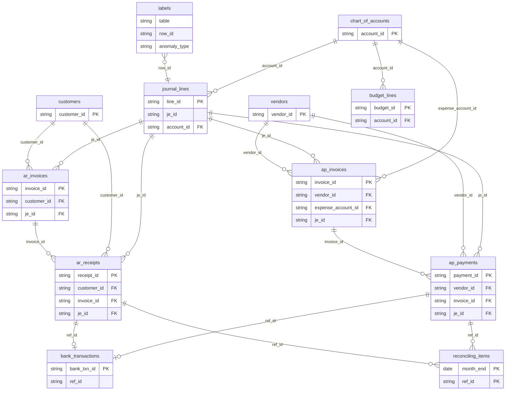

# synthbiz

  

Seeded synthetic finance data for one fictional small manufacturer. The tables link to each other and reconcile, and known problems are planted and labeled. Separate commands write synthetic workforce tables and project schedules.

The badges show the numbers from the last successful Pages build of main, so they can lag behind the latest commit. "Check the results yourself" below shows how to build them on your machine.

## Who it is for

- Data and analytics engineers who test finance pipelines, reconciliations and dashboards.
- Instructors and students in accounting analytics and data analytics courses.
- People building anomaly detection or matching tools who need labeled ground truth.

## 60-second quickstart

1. Clone the repo.

        git clone https://github.com/mehmetsean/synthbiz
        cd synthbiz

2. Make a virtual environment and install.

        python3 -m venv .venv
        source .venv/bin/activate
        pip install -e .

3. Generate a dataset.

        synthbiz generate --seed 42 --months 12 --size small --anomaly-rate 0.02 --out data/

4. Check it.

        synthbiz check data/

Python 3.11 or newer. Parquet output needs the extra: `pip install -e ".[parquet]"`, then add `--format parquet` to generate.

`generate` stops if the output folder is not empty. Add `--force` to replace the synthbiz files in it. Other files in the folder are left alone. `generate`, `workforce` and `project` stop before they change anything if one of their file names is taken by something other than a regular file or a link, such as a folder. A link is removed and its target is not touched. An empty folder path is refused.

## Workforce tables

A second generator writes synthetic workforce tables for shift scheduling tools. It is separate from the finance tables.

        synthbiz workforce --seed 42 --staff 20 --days 28 --out workforce/

It writes staff.csv, shifts.csv, demand.csv, availability.csv, data_dictionary.md, README.txt and manifest.json. Wages are integer cents and times are integer minutes. Staff is 1 to 500 and days is 1 to 366. The same seed gives the same bytes. Every file in the set is synthetic data. See docs/adr/0017-workforce-tables-separate-from-finance.md. `synthbiz check` does not read these folders.

## Project schedules

A third generator writes a synthetic project schedule for scheduling and schedule risk tools. It is separate from the finance and workforce tables.

        synthbiz project --seed 42 --tasks 50 --start-date 2025-01-06 --out project/

It writes project.xml (Microsoft Project XML, known as MSPDI), ranges.csv, risks.csv, data_dictionary.md, README.txt and manifest.json. All of it is synthetic data. The task count is 8 to 5000 and counts summary tasks and milestones. The start date is 2000-01-01 to 2099-12-31. A start date that is not a working day moves to the next one. The seed is 0 or more.

- The plan has phases. Each phase is a summary task over layers of work tasks and ends in a milestone.
- Each generated plan holds all four link types, with positive and negative lags. Negative lags are on FS links only. A lead (negative lag) is never longer than the predecessor's duration, and a link from a milestone has no lead. So a forward pass over the links, with summary tasks expanded, starts no task before the project start date. Links on summary tasks are FS or SS. A task with predecessors has at least one FS or SS predecessor. Lags are working time.
- Links go from an earlier layer to a later one, so the network has no cycle, also with summary tasks expanded.
- One calendar: Monday to Friday, 08:00 to 12:00 and 13:00 to 17:00, with US federal holidays as exceptions through the year in manifest.json. Juneteenth is listed from 2021. Dates after the last listed year have no holiday exceptions.
- ranges.csv (uid, dist, min, most_likely, max, corr_group) has one row per work task. The values are percent of plan duration.
- risks.csv (risk_id, probability, impact_dist, min_minutes, most_likely_minutes, max_minutes, min_cents, most_likely_cents, max_cents, affected_uids, corr_group) holds risk events with impacts in working minutes and in cents.
- A corr_group name in ranges.csv or risks.csv is on at least two rows of that file. Empty means no group.
- FixedCost and Cost in project.xml are in hundredths of the currency unit (cents). Microsoft does not state the unit on the pages named in docs/adr/0019-project-schedules.md, which also names the source used.
- The same seed, task count, start date and version give the same bytes.

`tests/test_project.py` checks the network, calendar and table rules across seeds, and `tests/test_project_files.py` checks the files, with the link type codes and lag units written out by hand. Run both with `pytest tests/test_project.py tests/test_project_files.py --no-cov`.

Not in the file: Start and Finish dates, durations of summary tasks, constraints, actuals, resources, task calendars, and percent or elapsed lags. No range uses a discrete distribution. The file has not been opened in Microsoft Project. `synthbiz check` does not read these folders. `project --force` refuses a folder with another kind of manifest.json, and so does `workforce --force`; `generate --force` has no such guard and replaces manifest.json, README.txt and data_dictionary.md. See docs/adr/0019-project-schedules.md for the element names and units.

## Budget and cash flow option

An option on `generate` adds a budget and the entries a cash flow statement needs. It is off by default, and an off run is unchanged.

        synthbiz generate --seed 42 --months 12 --budget-and-cash-flow --out data/

- `budget_lines.csv` (budget_id, period, account_id, amount_cents) has one row per period and revenue or expense account. Each amount is the journal result for that cell, except a planted set of cells that are changed by a percent or a fixed amount. labels.csv lists them as `budget_variance_pct` or `budget_variance_amount`, and each details text ends in `delta_cents=<signed cents>`. Budget minus the journal result equals that delta for a labeled cell and 0 for every other cell.
- Five new chart rows carry the roles FIXED_ASSET, ACCUM_DEPRECIATION, DEPRECIATION, LOAN and EQUITY_CONTRIBUTION. Entries post equipment purchases, monthly depreciation, a loan draw, monthly loan repayments and an owner contribution. Entries that move cash have a bank line with ref_type GL_ENTRY on the same date.
- `check` adds the rule budget_ties_to_journal when budget_lines is in the folder.
- manifest.json sets `parameters.budget_and_cash_flow` and writes `budget_variance_count`.

The loan has no interest and there are no asset disposals. The amounts are made up. See docs/adr/0018-budget-and-cash-flow-option.md. The numbers block below prints the example totals, including operating, investing and financing cash flow and the net change in cash, and `tests/test_plan_generate.py` checks that the change in cash equals their sum.

## Demo in the browser

https://mehmetsean.github.io/synthbiz/

The page runs the generator in your browser with Pyodide. Pick a seed, months, size and anomaly rate, see the check results and table previews, and download a zip. The page code is in `site/`.

All data stays in your browser. The page downloads Pyodide, micropip, their dependencies and the Python standard library from cdn.jsdelivr.net, and wheel.json and the synthbiz wheel from this site. It does not send your inputs or the generated data anywhere. You can check this in the browser's Network tab.

## Tables

Ten tables plus labels.csv, and budget_lines when the budget and cash flow option is on. Keys come from `src/synthbiz/schema.py`.

A label points to one row by table name and row id. The diagram draws one of the possible targets.

## What check tests

- balanced_entries: every journal entry has equal debits and credits.
- ap_ar_subledger_ties: open AP and AR in the subledgers equal the control
  accounts at each month end.
- bank_ties_to_gl_cash: bank balance plus reconciling items equals GL cash at
  each month end, and reconciling_items.csv matches.
- links: every key in the schema points to a real row, and every label points to
  a real row.
- dates: due dates, payments and receipts are not before their invoice, and each
  journal line's period matches its posting month. Two cases are allowed: a
  labeled out_of_period_entry, and a line posted in the close window (on or
  before the 3rd business day of its month) whose period is the previous month.
  A planted out_of_period_entry is never posted inside the close window, so the
  two cases do not overlap.
- budget_ties_to_journal: only when budget_lines is present. Each budget line equals the journal result for its period and account plus the change named in labels.csv, and no cell is listed twice.
- manifest: every file still has the sha256 recorded in manifest.json.

A folder without labels.csv and manifest.json is read, and `check` prints a SKIP line for each missing file. The last line says how many checks were skipped, for example "All checks passed, 2 skipped". Skips do not change the exit code. If only labels.csv is removed, the manifest check fails, because manifest.json lists labels.csv.

Without labels.csv, the dates check cannot tell a planted out_of_period_entry from a real error, so it reports those entries as FAIL and `check` exits with 1. That output points at the planted anomalies, so do not hand out the check output together with the data. A dataset made with `--anomaly-rate 0` has no planted anomalies, so it passes after both labels.csv and manifest.json are removed. A low anomaly rate does not guarantee this. With `--budget-and-cash-flow` the budget variances are always planted, whatever the anomaly rate is, so without labels.csv the rule budget_ties_to_journal fails and its output lists the planted cells.

For any bad input, `check` prints one line like `Error: vendors.csv: line 4 has 3 fields, expected 4` and exits with 1. The CLI tests check that these cases print no traceback. This covers every table file and labels.csv: wrong or reordered columns, a wrong field count, a blank row in the middle, a file that is not UTF-8 or not valid CSV, an unreadable file, and a Parquet file that cannot be read. It also covers a value that is not an integer or a date, in CSV and in Parquet. CSV errors give the physical line number, as in `line 4`. Parquet errors give the row number, as in `Error: bank_transactions.parquet: row 1: amount_cents is not a valid integer`. If a check itself fails on odd data, `check` prints one line starting with `Error: could not run the checks` and exits with 1.

## Check the results yourself

Run these from the repo folder.

    pytest
    python scripts/reproduce_readme.py --check
    synthbiz check examples/seed42-3m

- `pytest` runs the tests, including property tests across random seeds, and fails under 90 percent coverage.
- `reproduce_readme.py --check` rebuilds every number in the block below and fails if the README is out of date.
- `synthbiz check examples/seed42-3m` runs the checks on the committed sample. See `examples/README.md`.
- To check the manifest hash by hand, run the quickstart generate command (seed 42, 12 months, size small, rate 0.02), then `shasum -a 256 data/manifest.json`. It must equal the sha256 at the end of the numbers block. The 3 month sample in examples/ is a different run, so its hash is different.

To build the same two badge files on your machine, run these after `pip install -e ".[dev]"`. The numbers can differ from the Pages build if your Python or packages differ. The SVG files go to badge-check/badges.

    pytest --junitxml=badge-check/junit.xml --cov-report=json:badge-check/coverage.json
    python scripts/make_badges.py badge-check/coverage.json badge-check/junit.xml badge-check/badges

## Background rows

By default the ledger also holds legitimate activity that looks a little like an anomaly but is not one. These rows are not in labels.csv. manifest.json lists how many of each kind exist under `background_counts`, and writes the approval limit as `approval_limit_cents`.

- system_batch_weekend: a system entry on a weekend each month and on each US federal holiday, with no approver.
- system_recurring: two system entries a month on business days, with no approver.
- close_window_accrual: manual accruals in the first 3 business days of a month, booked to the previous period.
- human_weekend_close: one manual accrual on a weekend at each quarter end.
- round_rent_accrual: the same round amount every month.
- round_retainer_invoice: one vendor, the same round amount, invoice number RET-YYYYMM.
- recurring_fixed_invoice: one vendor, the same amount every week, invoice numbers one apart (FR-00123, FR-00124).
- occasional_poster: a rare poster, the CFO each quarter end and a tax accountant once a year.

Why: a rule that flags weekends, missing approvers, round amounts or similar invoice numbers should flag these rows too. On a dataset with only planted anomalies, a rule that flags weekend entries would score a precision of 1.0 at the entry level, which says nothing about the rule. With these rows the false alarm rate of a rule shows up in the numbers. Entries that the rule flags and the labels do not point to count as false alarms. For a journal anomaly, labels.csv names the first journal line of its entry. Other labels name a row in their own table.

The background step runs after the planted anomalies. Every journal, invoice, payment and receipt row of the background-off run is unchanged in the background-on run, with its id and values. Existing bank rows are unchanged except bank_txn_id, which is renumbered after sorting. The background step also adds bank rows. reconciling_items is rebuilt from the bank and GL dates and gains rows. Turn background off with `synthbiz generate --no-background`. manifest.json then sets `parameters.background` to false and every count in `background_counts` is 0. With `--no-background`, the journal and bank files match 0.1.2 byte for byte only when at most two anomalies are planted. manifest.json and README.txt always differ from 0.1.2, because they hold the new fields and notes.

## Performance

`check` buckets rows by month end with a binary search, so it reads each row once instead of once per month end. At 36 months, check is faster than before in the results table in docs/benchmark.md. `generate` calls the same `reconciling_items` code, and its output files are unchanged: `tests/test_examples.py` generates the same sample into a temporary folder and compares every file byte for byte with examples/seed42-3m. `benchmarks/bench.py` times `check` against the old code and a simple unlinked generator, and fails if the results differ. See docs/benchmark.md for the commands and a results table.

## Limits

- The finance generator is one fictional company with ten tables, and an eleventh with the budget and cash flow option. The workforce generator is separate and has four tables. The project generator is separate too.
- Workforce demand and availability are drawn independently, so a schedule may be impossible. For example `--staff 1 --days 1` leaves one person to cover the day, evening and night shifts.
- Dates must be written YYYY-MM-DD. check refuses a journal that spans more than 1200 months, and it stops when the reconciling items would pass 200,000. Integer columns accept only plain digits with an optional minus sign, up to 18 digits. A Parquet file with more than 3,000,000 rows is refused from its metadata. A CSV file is stopped once it passes 3,000,000 rows. A folder may hold at most 5,000,000 rows in total.
- Holidays are US federal holidays only. The finance tables treat Juneteenth as a holiday in every year, also before 2021, the year of the law that added it (https://www.govinfo.gov/app/details/PLAW-117publ17). Project schedules list it from 2021.
- No multi-currency, payroll or tax.
- Amounts, timing and rates are not real-world statistics. This includes project durations, costs, ranges and risks.
- Project schedules: A work task's Cost is FixedCost plus a day rate times its duration in days. The file holds no resources or assignments, so a tool that recomputes cost may get other totals.
- Anomaly types are planted in a fixed rotation, so a low rate or a short run will
  not include all ten types. The example below has six.
- Background rows are generated for the same fictional company only. They are one
  fixed set of patterns, not a model of real posting behavior.

## Numbers in this README

Every number below comes from `python scripts/reproduce_readme.py`. Run it with
`--check` to see if this block still matches a fresh run. The manifest hash
includes the package version, so it changes when the version changes.

<!-- numbers:start -->
Example: seed 42, 12 months, size small, anomaly rate 0.02.

Rows per table:

- chart_of_accounts: 11
- journal_lines: 1440
- vendors: 9
- ap_invoices: 217
- ap_payments: 185
- customers: 6
- ar_invoices: 120
- ar_receipts: 92
- bank_transactions: 278
- reconciling_items: 21
- labels: 6

Total rows: 2379 (not counting labels)

Planted anomalies: 6

- exact_duplicate_payment: 1
- near_duplicate_payment: 1
- round_amount_entry: 1
- split_invoice: 1
- typo_duplicate_payment: 1
- weekend_posting: 1

Background rows (legitimate, not labeled):

- close_window_accrual: 11
- human_weekend_close: 4
- occasional_poster: 5
- recurring_fixed_invoice: 53
- round_rent_accrual: 12
- round_retainer_invoice: 12
- system_batch_weekend: 23
- system_recurring: 24

Checks:

- balanced_entries: PASS
- ap_ar_subledger_ties: PASS
- bank_ties_to_gl_cash: PASS
- links: PASS
- dates: PASS
- manifest: PASS

manifest.json sha256: 37fcd47baaa323bec03f0578a8ef9aa2ca675fe011d76fc1829bbdcdb13edcb5

Budget and cash flow option: seed 42, 12 months, size small.

- budget_lines: 84
- budget_variance_amount: 4
- budget_variance_pct: 4
- variance rate: 0.1
- minimum result for a variance, cents: 100000
- chart_of_accounts: 16
- equipment at cost, cents: 33000000
- accumulated depreciation, cents: 5150000
- loan balance, cents: 20000000
- owner contributions, cents: 5000000
- operating cash flow, cents: 73606045
- investing cash flow, cents: -33000000
- financing cash flow, cents: 125000000
- net change in cash, cents: 165606045
- cash flow identity: PASS
- balanced_entries: PASS
- ap_ar_subledger_ties: PASS
- bank_ties_to_gl_cash: PASS
- links: PASS
- dates: PASS
- budget_ties_to_journal: PASS
- manifest: PASS

Workforce example: seed 42, 20 staff, 28 days.

- tables: 4
- staff: 20
- shifts: 3
- demand: 224
- availability: 103
- staff limit: 1 to 500
- days limit: 1 to 366
- first names: 26
- last names: 22
- name pairs: 572
- demand shares: DAY 0.25, EVE 0.2, NIGHT 0.1
- weekend factor: 0.6
- same seed gives same bytes: PASS
- availability rows, upper bound: 183000
- availability rows, measured at the limits: 32935

Project example: seed 42, 50 tasks.

- tasks: 50
- summary tasks: 3
- milestones: 3
- links: 75
- FS links: 65
- SS links: 7
- FF links: 2
- SF links: 1
- positive lags: 11
- negative lags: 2
- holiday exceptions: 43
- holidays listed through year: 2028
- ranges: 44
- risks: 3
- same seed gives same bytes: PASS
- task limit: 8 to 5000
- start date limit: 2000-01-01 to 2099-12-31
- links at the task limit: 9470
- risks at the task limit: 200
<!-- numbers:end -->

See docs/spec.md for scope, DATA.md for data sources and docs/adr/ for design decisions.

## Contributing

Outside code contributions are not accepted. Bug reports by issue are welcome.

## License

All rights reserved. You may view the code and run it to evaluate it. Commercial use needs a paid license from Mehmet Tuzunkan: https://www.linkedin.com/in/mstuzunkan

Any other use needs written permission, except where LICENSE says otherwise. See LICENSE.

Synthetic data for testing and learning only. Any match with a real business is unintended. Decision support only, not legal, tax, accounting or assurance advice. No guarantee of compliance.
